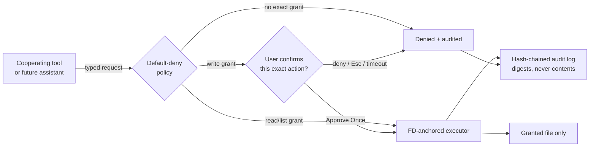

<p align="center">
  
</p>

<h1 align="center">XOR OS</h1>

<p align="center">
  <strong>Beauty with a permission boundary.</strong><br>
  A Debian GNU/Linux desktop in the making, crowned with the original
  <strong>Aurora Shell</strong> and protected by a default-deny permission broker.
</p>

<p align="center">
  <a href="https://github.com/Rishidev-20thcenturey/XOR-OPERATING-SYSTEM-/actions/workflows/ci.yml"></a>
  
  
  
</p>

<p align="center">
  
</p>

<p align="center"><em>Royal Aurora — XOR's default wallpaper and Aurora Shell design direction. This is a design asset, not a claimed boot screenshot.</em></p>

---

## ✨ What is XOR OS?

XOR OS is a trustworthy desktop operating system being built in the
open by a small team with a $0 starting budget. We reuse the proven
Linux kernel and Debian package universe instead of reinventing them,
then put our originality where it matters:

* a lavish, original desktop called **Aurora**;
* a **permission broker** that mediates tool access to your files;
* per-write user approval that cannot be replayed for another action;
* a local, tamper-evident record of every broker decision;
* an assistant that stays **off** until isolation and security gates pass.

> **Nothing is granted implicitly.** A cooperating tool may touch only
> the exact resource you granted, for the exact operation you granted.
> Selecting one file never silently grants its folder, your home
> directory, a shell or the network.

This repository contains a **tested broker and OS foundation plus the
Aurora Shell preview**. The ISO now builds successfully in GitHub
Actions (`.github/workflows/iso-build.yml`), but the bounded QEMU/TCG
boot check returned **INCONCLUSIVE** there; the workflow therefore failed
its final gate. No bootloader/GUI boot was claimed. That honesty is
recorded in [`docs/TEST_RESULTS.md`](docs/TEST_RESULTS.md).

## 🌌 Aurora — the XOR desktop

Aurora is our original glass desktop experience, currently layered over
the dependable XFCE/X11 session while it earns replacement status.

| Aurora surface | Experience |
|---|---|
| **Glass top panel** | XOR launcher, workspaces, live clock, active window, network & battery pills, Command Centre, Control Centre and power menu |
| **Floating dock** | Pinned apps, large luminous icons, live running-window buttons via Wnck, Trash shortcut |
| **Full-screen launcher** | Real app discovery, weighted search, category pills, generous app cards; Enter opens the best match, Esc closes |
| **Command Centre** | Honest live network, battery and memory cards with shortcuts to files, sound, displays, screenshot, appearance and security |
| **Control Centre** | Overview, Appearance, Security, System and About; four accent palettes, wallpaper picker, dock size/position/opacity, reduce-motion, broker audit summary |
| **Royal Aurora identity** | Midnight glass wallpapers, scalable glass-X logo, teal/violet/gold CSS design tokens and visible keyboard focus |

XFCE remains available as the recovery/fallback session during the
preview. Aurora does not pretend fake toggles work, and a shell gesture
can never substitute for a broker permission approval.

Explore the design notes in [`docs/XOR_SHELL.md`](docs/XOR_SHELL.md).

## 🛡️ The permission broker

The broker is the security heart of XOR. Cooperating tools send a
typed request; the broker decides, confirms writes, executes through
FD-anchored filesystem operations and audits the result.



### Security properties implemented and tested

* **Default-deny** capability manifests, strictly validated.
* Exact **file** grants; directory grants only when explicitly created.
* `O_NOFOLLOW` + `dir_fd` traversal defeats path traversal, symlink
  escapes and validation/execution races.
* Writes require a **single-use, digest-bound, 120-second** approval.
* Delete, network-send and process-exec exist in the API only to be
  **denied and audited**; manifests cannot grant them.
* Every request attempts one SHA-256 hash-chained audit record with
  metadata/digests — never raw file content; an append failure is
  reported explicitly.
* Hostile document text is never consulted by policy.

### Follow-up hardening

The latest review follow-up strengthened the broker without changing the
default-deny model:

* Audit-chain verification and `max_uses` counts are rebuilt from the
  same locked file descriptor. Malformed or hash-invalid records,
  replaced/deleted log paths and in-process tail truncation fail closed.
* Selected-directory `list_dir` grants are inode-pinned; the executor
  checks the opened directory before returning its contents.
* Pinned write targets are opened without `O_TRUNC`; the opened inode is
  checked before any change, so replacing or deleting a selected file
  fails closed and leaves the replacement untouched.
* Unpinned writes are staged inside a private `0700` directory anchored
  to the target directory's file descriptor and renamed into place; a
  failed write leaves the original content intact, and other users cannot
  read or substitute the staged bytes. Pinned writes update the pinned
  inode in place with a backup/rollback copy, and zero-progress `write()`
  results fail explicitly instead of looping.
* Manifest loading shares `xor-broker init`'s no-follow and
  regular-file policy.
* If the audit append fails after an action, the broker returns an
  explicit `audit_failure` and no result data instead of a false success.

See [`broker/README.md`](broker/README.md),
[`docs/THREAT_MODEL.md`](docs/THREAT_MODEL.md) and
[`docs/TEST_RESULTS.md`](docs/TEST_RESULTS.md) for the exact guarantees,
remaining limits and test evidence.

**Limits unchanged:** execution and audit append are not crash-atomic;
pinned-write rollback protects against reported errors, not a crash in the
middle of an in-place update. An append failure is reported but cannot undo
an action. The broker is not system-wide confinement, and the ISO build/QEMU
boot verification was not accepted in the 2026-10-27 cloud run
(`INCONCLUSIVE`, final gate failed).

The boundary mediates requests **through the broker API**. It is not
yet system-wide syscall confinement. The complete honest model is in
[`docs/THREAT_MODEL.md`](docs/THREAT_MODEL.md).

## 🚀 Try the broker in 60 seconds

No ISO, root, display or downloads required — only Python 3.9+:

```sh
git clone https://github.com/Rishidev-20thcenturey/XOR-OPERATING-SYSTEM-.git
cd XOR-OPERATING-SYSTEM-

PYTHONPATH=broker/src python3 -m xor_broker.cli demo
# Type the word: approve
```

You will see a granted read succeed; a sibling secret and `../`
traversal denied; a write pause for approval; a network send refused;
and the tamper-evident audit trail tying it together.

```sh
tools/test.sh       # 94 tests + 200-scenario security corpus
tools/validate.sh   # code, assets, docs inputs and live-build wiring
```

## 💎 Try Aurora

On a graphical Linux machine with GTK 3 / PyGObject:

```sh
PYTHONPATH=desktop:broker/src python3 -m xor_shell

# Individual surfaces
PYTHONPATH=desktop:broker/src python3 -m xor_shell --launcher
PYTHONPATH=desktop:broker/src python3 -m xor_shell.control_center
```

Headless proof points used by tests and CI:

```sh
PYTHONPATH=desktop:broker/src python3 -m xor_shell --status-json
PYTHONPATH=desktop:broker/src python3 -m xor_shell --list-apps
PYTHONPATH=desktop:broker/src python3 -m xor_shell.control_center --text
```

## 💿 Build and boot the OS image

The dedicated GitHub Actions workflow
[`.github/workflows/iso-build.yml`](.github/workflows/iso-build.yml) runs
this build on `ubuntu-latest` for the ISO-hardening review branch and
uploads the build/QEMU evidence. On a Debian/Ubuntu development machine
with Debian mirror access:

```sh
sudo apt install live-build qemu-system-x86 ovmf
sudo tools/build-iso.sh
tools/run-qemu.sh
```

The fixed virtual target is QEMU `q35`, 2 vCPU, 4 GiB RAM,
virtio-vga, virtio block/network, USB keyboard/tablet and serial
logging. Live user: `user` (password `live` if prompted).

Each build writes the ISO SHA-256 and `BUILD-MANIFEST.txt`. We do
**not** claim bit-for-bit reproducibility yet. Before `lb build`, the
script checks every package name and dependency name against the
configured Debian trixie/updates/security indices. A failed `lb` build
is never hidden by `tee`, and only an ISO that is new or changed since
the pre-build snapshot is accepted; old ISOs are preserved but never
reported as the current artifact. `--clean` explicitly removes prior
build outputs.

## ✅ Evidence, not promises

Latest verified results (2026-10-27, Termux/Android, Python 3.13.13):

* **94 unit tests passed** under unittest: 80 broker (including
  corpus-as-test), 3 assistant-gate and 11 desktop/Activity/Aurora.
  Write regressions prove a replaced pinned file keeps its contents,
  deleted pinned targets are not recreated, failed/zero-progress writes
  preserve the original (atomic staging for unpinned writes, rollback for
  pinned writes), staging is private `0700` (file created `0600`) and
  source-name substitution cannot redirect the rename, staging cleanup is
  identity-checked (and may leave an empty directory in unsafe shared
  parents), and symlink targets fail closed.
* **200 security scenarios + 50 injection twins passed**:
  0 out-of-grant actions executed, 0 network sends, 0 unconfirmed
  writes, 0 audit/content leaks, 45/45 legitimate approved actions.
* **Build-script regressions passed** with a fake `lb`: failed builds
  return failure through `tee`, failed package validation blocks the
  build, a stale ISO is never selected, and old artifacts are preserved.
* **Package list preflight passed** against the live trixie/updates/
  security indices: 40 requested packages, 69,222 package names, and
  dependency names resolve. A negative control with `Thunar-volman`
  failed with a lowercase-name suggestion.
* Static validation passes across 35 Python files, CSS/logo/wallpapers,
  desktop entries, shell scripts and live-build wiring. ShellCheck
  0.11.0 is clean; pyflakes was not installed and is reported as
  skipped (no pyflakes-clean claim).
* **ISO build passed** in GitHub Actions run 40542700041; the ISO was
  checksummed and the build artifacts were uploaded. **The QEMU boot
  check was `INCONCLUSIVE`** and the final workflow gate failed. **GTK
  behaviour was NOT RUN.** The detailed rows are in
  [`docs/TEST_RESULTS.md`](docs/TEST_RESULTS.md).

## 🗺️ Road to the complete XOR OS

| Phase | Status | Destination |
|---|---|---|
| Foundation + broker | ✅ Test-proven | Default-deny, auditable core |
| ISO proof | 🧪 Build PASS; QEMU inconclusive | Retry the bounded QEMU live-session signal, then boot evidence |
| Aurora Shell | 🧪 Preview implemented | Daily-use panel, dock, launcher, controls |
| Product system | 📝 Planned | Installer, first-run, grants UI, curated apps |
| A/B updates | 📝 Designed | Signed, verified, rollback-tested updates |
| Read-only assistant | 🔒 Disabled | Sandbox-isolated, broker-only access |
| Hardening/hardware | ⬜ Future | Fuzzing, identity, TPM, broader machines |

The complete gate-by-gate plan lives in
[`docs/PRODUCT_PLAN.md`](docs/PRODUCT_PLAN.md).

## 🧭 Repository map

```text
XOR-OPERATING-SYSTEM-/
├── broker/          Permission broker, daemon, CLI and unit tests
├── desktop/
│   ├── xor_shell/   Aurora panel, dock, launcher and Control Centre
│   ├── theme/       Wallpapers, logo and XFCE fallback defaults
│   ├── applications Menu + session-autostart entries
│   └── xor_activity Audit Activity viewer
├── assistant/       Disabled future-assistant integration gate
├── security/        200 deterministic adversarial scenarios
├── os/live-build/   Debian Live Build image configuration
├── tools/           Build, QEMU, test and validation scripts
└── docs/            Architecture, threat model, plans, tests and ADRs
```

## 📚 Documentation

* [`docs/DEVELOPMENT.md`](docs/DEVELOPMENT.md) — set up and build
* [`docs/ARCHITECTURE.md`](docs/ARCHITECTURE.md) — components and boundaries
* [`docs/XOR_SHELL.md`](docs/XOR_SHELL.md) — Aurora surfaces and keyboard contract
* [`docs/PRODUCT_PLAN.md`](docs/PRODUCT_PLAN.md) — path to a complete OS
* [`docs/TESTING.md`](docs/TESTING.md) — how each claim is verified
* [`docs/TEST_RESULTS.md`](docs/TEST_RESULTS.md) — actual numbers and NOT RUN items
* [`docs/THREAT_MODEL.md`](docs/THREAT_MODEL.md) — prevents / detects / does-not-address
* [`docs/UPDATE_DESIGN.md`](docs/UPDATE_DESIGN.md) — future A/B updater
* [`docs/adr/`](docs/adr/) — architecture decision records

## 🤝 Principles

* **Reuse the kernel; invent the trust experience.**
* **Lavish means coherent, accessible and useful—not noise.**
* **Security before AI.** The assistant remains disabled by design.
* **No simulated success.** Unsupported capabilities are denied, and
  unverified work is labelled unverified.
* **A new contributor should reach green tests in minutes.**

Contributions are welcome — begin with
[`CONTRIBUTING.md`](CONTRIBUTING.md). Security reports follow
[`SECURITY.md`](SECURITY.md), not public issues.

## 📜 Licence

XOR project code is under the MIT Licence ([`LICENSE`](LICENSE)).
The assembled OS image contains Debian packages under their own free
licences.

<p align="center">
  <strong>XOR OS — take back the desktop, one explicit permission at a time.</strong>
</p>
