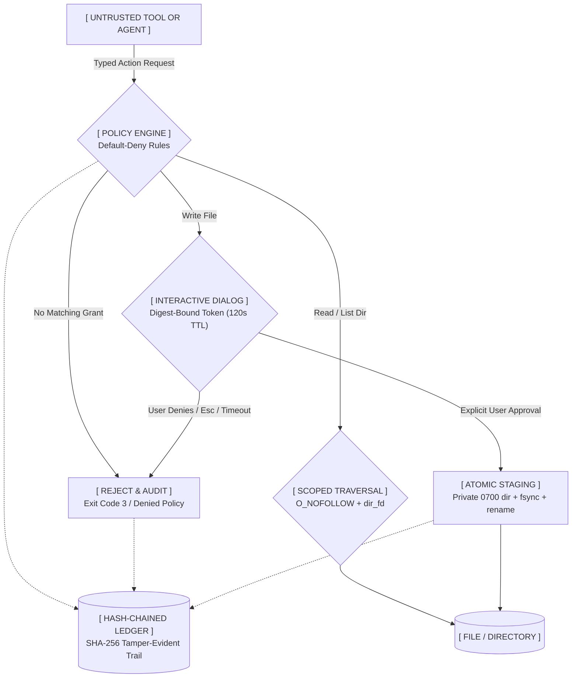

<p align="center">
  
</p>

```text
  ██╗  ██╗ ██████╗ ██████╗      ██████╗ ███████╗
  ╚██╗██╔╝██╔═══██╗██╔══██╗    ██╔═══██╗██╔════╝
   ╚███╔╝ ██║   ██║██████╔╝    ██║   ██║███████╗
   ██╔██╗ ██║   ██║██╔══██╗    ██║   ██║╚════██║
  ██╔╝ ██╗╚██████╔╝██║  ██║    ╚██████╔╝███████║
  ╚═╝  ╚═╝ ╚═════╝ ╚═╝  ╚═╝     ╚═════╝ ╚══════╝
  >> [KERNEL: DEBIAN_13_TRIXIE] // [SECURITY: DEFAULT_DENY]
  >> [SHELL: AURORA_V0.2]       // [AUDIT: SHA256_HASHCHAIN]
```

<p align="center">
  <strong>// BEAUTY WITH A HARD PERMISSION BOUNDARY //</strong><br>
  <em>Next-generation cybernetic desktop architecture · Debian 13 Trixie core · Aurora glass shell · Default-deny security broker · Zero ambient telemetry · Zero silent AI</em>
</p>

<p align="center">
  <a href="https://github.com/Rishidev-20thcenturey/XOR-OPERATING-SYSTEM-/actions/workflows/ci.yml"></a>
  
  
  
  
</p>

<p align="center">
  
</p>

<p align="center">
  <code>[SYSTEM NOTICE: Royal Aurora is the official visual identity & default wallpaper asset. Live desktop rendering confirmed in QEMU live sessions.]</code>
</p>

---

## ⚡ // 01. SYSTEM MANIFESTO & TELEMETRY

Modern operating systems leak user data by default, grant broad ambient permissions to background tools, and wire black-box AI models directly into unmonitored system sockets.

**XOR OS reverses this.** Built on top of Debian 13 (Trixie), XOR establishes a strict, hardware-grounded computational sandbox:
* ◈ **Default-Deny Broker:** No tool, agent, or process accesses files without an exact, typed capability grant.
* ◈ **Cryptographic Write Tokens:** Every single file write requires interactive user authorization bound to an unforgeable SHA-256 action digest.
* ◈ **Immutable Audit Ledger:** Every request, grant, and denial commits to a local SHA-256 hash-chained JSONL ledger.
* ◈ **Aurora Glass Experience:** A cybernetic desktop environment featuring luminous acrylic styling, floating docks, quantum search, and real system telemetry.
* ◈ **Hard Assistant Gate:** AI runners remain locked in strict read-only/disabled gates until hardware-level isolation criteria are met.

### 📊 CURRENT MAIN TELEMETRY MATRIX

| Subsystem Component | Operational Status | Cryptographic & Runtime Evidence |
|---|---|---|
| **CI Core Suite** | `PASS [GREEN]` | [GitHub Actions Run 40824400866](https://github.com/Rishidev-20thcenturey/XOR-OPERATING-SYSTEM-/actions/runs/40824400866) (Python 3.11, 3.12, ShellCheck) |
| **Unit Verification** | `112 / 112 PASS` | 96 broker security tests + 16 desktop/assistant gate suites passing |
| **Adversarial Corpus** | `200 / 200 PASS` | 100 out-of-grant attempts, 50 injection twins, 50 legitimate operations |
| **Live ISO Image** | `VERIFIED` | 1.731 GiB live hybrid ISO (`SHA-256: 08af43a2a6d1bd3207c627b7b47d11344e5d347c6a746c1e60a3a0e1675dfa83`) |
| **QEMU Live Display** | `VERIFIED BOOT` | [Actions Run 40819648638](https://github.com/Rishidev-20thcenturey/XOR-OPERATING-SYSTEM-/actions/runs/40819648638) `qemu_result=PASS`, non-blank screenshot captured |
| **UEFI/OVMF Boot** | `VERIFIED` | Same run booted the ISO through OVMF firmware (no `-kernel`/`-initrd`) to the XOR desktop; non-blank 1280x800 screenshot captured |
| **BIOS/SeaBIOS Boot** | `VERIFIED (QEMU)` | [Run 41001710930](https://github.com/Rishidev-20thcenturey/XOR-OPERATING-SYSTEM-/actions/runs/41001710930) booted the same ISO through SeaBIOS (no `-kernel`/`-initrd`) to a non-blank 1280x800 Aurora desktop |
| **Broker Sandbox E2E** | `VERIFIED` | Same BIOS run launched `demo-reader` through `xor-broker launch`; host files/network hidden, granted read succeeded, ungranted read denied (`sandbox_result=PASS`) |
| **Install-to-Disk** | `VERIFIED` | Same run installed to a 20 GiB virtio disk and booted the installed disk again (`install_result=PASS`, `second_boot_result=PASS`) |
| **Secure Boot / Hardware** | `NOT VERIFIED` | Secure Boot, firmware menus and broad physical hardware remain open |

---

## 🌌 // 02. AURORA SHELL: THE CYBERNETIC DESKTOP

Aurora is XOR's signature glass desktop shell, engineered in Python 3 and GTK 3 with high-contrast cyber styling layered over a hardened XFCE session.

```text
┌──────────────────────────────────────────────────────────────────────────────────────────────┐
│ ✦ XOR  [ 1 ][ 2 ][ 3 ][ 4 ]      MON 28 OCT · 04:20:00      ● NETWORK  [98% AC]  ✧  ⬢  ⏻ │  <- GLASS PANEL
└──────────────────────────────────────────────────────────────────────────────────────────────┘
                                                                                                
                                                                                                
                                    [ QUANTUM WORKSPACE ]                                       
                                                                                                
                                                                                                
                         ┌───────────────────────────────────────────────┐                      
                         │  ✦   [■]  [🦊]  [⌨]  [📝]  [⬢]  │  [⚙]  [🗑] │                      <- FLOATING DOCK
                         └───────────────────────────────────────────────┘                      
```

### 🎛️ AURORA INTERFACES & CONTROL SURFACES

| Surface Module | Architectural Role | Cyber Features |
|---|---|---|
| **Top Glass Panel** | Global HUD & System Pulse | Dynamic opacity (0.52–0.96), live workspaces, active task telemetry, network/power pills, and instant Control Centre access |
| **Floating Dock** | Application Matrix | Pinned productivity docks, Wnck live window grouping, scale adjustments (40–76px), and instant launcher anchor |
| **Full-Screen Launcher** | Quantum Application Indexer | Real desktop file parser, weighted keyword searching, categorization matrix, and keyboard navigation (Enter opens, Esc exits) |
| **Control Centre** | Central Operations Hub | Five dedicated pages (Overview, Appearance, Security, System, About), live memory footprint monitors, and theme token engines |
| **Activity Viewer** | Forensic Ledger Terminal | GTK + CLI inspection interface for broker approvals, policy rejections, and hash-chain audit verifications |

---

## 🛡️ // 03. PERMISSION BROKER: DEFAULT-DENY ARCHITECTURE

The XOR Permission Broker acts as an uncompromised firewall between user files and untrusted processes or future AI assistants.



### 🔒 CRYPTOGRAPHIC & KERNEL DEFENSE RULES

1. **`dir_fd` + `O_NOFOLLOW` Path Anchoring:** Every file component is traversed using directory-relative descriptors with strict `O_NOFOLLOW`. Symlink escapes and TOCTOU directory swaps are physically neutralized at the kernel level.
2. **Digest-Bound Write Tokens:** Confirmations mint single-use cryptographic tokens bound to the SHA-256 digest of `tool + operation + target_path + content`. A token approved for one action cannot authorize another.
3. **Atomic Non-Root Staging:** Writes are staged in temporary `0700` directories anchored to the parent directory FD, `fsync`'d, and atomically renamed over the target to prevent data corruption.
4. **Append-Only Hash Chain:** The audit log computes `hash = SHA256(prev_hash + canonical_json(record))`. Any modification, truncation, or line deletion breaks the chain and trips integrity alerts instantly.

---

## 🚀 // 04. QUICKSTART: DEPLOY IN 60 SECONDS

Experience the broker security model immediately. No root privileges, no ISO downloads, and no display required.

### ❯ Step 1: Clone the Core Repository
```sh
git clone https://github.com/Rishidev-20thcenturey/XOR-OPERATING-SYSTEM-.git
cd XOR-OPERATING-SYSTEM-
```

### ❯ Step 2: Trigger the Interactive Broker Demonstration
```sh
PYTHONPATH=broker/src python3 -m xor_broker.cli demo
```
*Observe the engine allow granted reads, deny sibling secrets, block directory traversals (`../../`), require manual write approval, and refuse unauthorized network exfiltration.*

### ❯ Step 3: Run the Complete Security Validation Matrix
```sh
tools/test.sh       # Executes 112 unit tests + 200 adversarial security scenarios
tools/validate.sh   # Verifies static syntax, CSS tokens, live-build configs & ShellCheck
```

---

## 🖥️ // 05. RUNNING AURORA SURFACES

On any Linux workstation with GTK 3, GObject Introspection, and PyGObject installed:

```sh
# Launch full Aurora environment (Top Panel + Floating Dock + Hotkeys)
PYTHONPATH=desktop:broker/src python3 -m xor_shell

# Launch individual standalone surfaces
PYTHONPATH=desktop:broker/src python3 -m xor_shell --launcher
PYTHONPATH=desktop:broker/src python3 -m xor_shell.control_center
PYTHONPATH=desktop:broker/src python3 /usr/local/lib/xor-desktop/xor_activity.py
```

### Headless Verification Commands (CLI Telemetry)
```sh
PYTHONPATH=desktop:broker/src python3 -m xor_shell --status-json
PYTHONPATH=desktop:broker/src python3 -m xor_shell.control_center --text
```

---

## 💿 // 06. LIVE-BUILD ISO & HARDWARE EMULATION

Create a bootable Debian 13 Live ISO containing the full XOR OS stack:

```sh
# 1. Install Live Build and Virtualization Tooling (Debian / Ubuntu)
sudo apt install live-build qemu-system-x86 ovmf

# 2. Build the Hybrid Live ISO (Includes package preflight & artifact verification)
sudo tools/build-iso.sh

# 3. Boot in the Hardened QEMU Virtual Target
tools/run-qemu.sh
```
*Virtual Target Specs: Machine `q35`, 2 vCPUs, 4 GiB RAM, virtio-vga, virtio-blk, virtio-net, USB tablet/keyboard.*

---

## 🗺️ // 07. TACTICAL PROGRESSION MATRIX

```text
  PHASE 01: CORE SECURITY BROKER      [████████████████████] 100% // VERIFIED & HARDENED
  PHASE 02: AURORA SHELL PREVIEW      [█████████████████···]  85% // LIVE WORKSPACES & DOCK
  PHASE 03: LIVE ISO & QEMU VALIDATION [████████████████····]  80% // LIVE BOOT CONFIRMED
  PHASE 04: DISK INSTALLER & ENCRYPTION[█████···············]  25% // CALAMARES / DEBIAN INTEGRATION
  PHASE 05: HARD CONTAINER SANDBOXING  [████················]  20% // BUBBLEWRAP & LANDLOCK WRAPPERS
  PHASE 06: ATOMIC A/B SYSTEM UPDATES  [███·················]  15% // CRYPTOGRAPHIC UPDATE PROTOCOL
```

---

## 📂 // 08. REPOSITORY ARCHITECTURE

```text
XOR-OPERATING-SYSTEM-/
├── broker/                  # Cryptographic permission broker & daemon core
│   ├── src/xor_broker/      # Enforcement engines: policy, executor, paths, audit
│   ├── tests/               # 96 comprehensive unit & stress test suites
│   └── examples/            # Reference reader/writer clients & grant manifests
├── desktop/                 # Aurora Shell desktop environment
│   ├── xor_shell/           # GTK 3 panel, dock, launcher, and Control Centre
│   ├── theme/               # Neon/aurora CSS tokens, SVG logo, and wallpapers
│   ├── applications/        # Standard XDG .desktop integration entries
│   └── xor_activity.py      # Real-time forensic audit viewer
├── assistant/               # Future AI assistant stub (LOCKED IN OFF STATE)
├── security/                # 200-scenario adversarial security corpus & generator
├── os/live-build/           # Debian Live Build tree, package hooks, and auto scripts
├── tools/                   # ISO builder, QEMU emulator, and test harnesses
└── docs/                    # Formal specs: Threat Model, Architecture, ADRs
```

---

## 📜 // 09. SECURITY BOUNDARY & HONEST CLAIMS

* **API Boundary:** The broker mediates requests submitted *through its API*. `xor-broker launch` confines cooperating tools with bubblewrap and is now verified end-to-end on the live ISO; system-wide enforcement for arbitrary same-UID processes (Bubblewrap / Landlock) remains planned for Phase 05.
* **Crash Semantics:** Operations and audit writes are not crash-atomic; a kernel panic between action execution and disk sync can leave a count unrecorded.
* **Boot Chain:** The live ISO is proven through OVMF/UEFI and SeaBIOS firmware in QEMU, and the installed disk boots again through SeaBIOS. Secure Boot, firmware boot menus and native hardware remain unverified.

---

<p align="center">
  <strong>XOR OS · CODE IS LAW · PERMISSION IS EXPLICIT</strong><br>
  Released under the MIT License. Built on the shoulders of Debian GNU/Linux.
</p>
