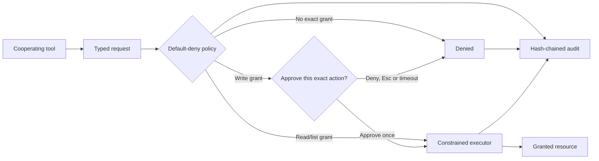

<p align="center">
  
</p>

<h1 align="center">XOR OS</h1>

<p align="center">
  <strong>A considered desktop. Explicit permissions. Security before AI.</strong><br>
  A Debian GNU/Linux desktop prototype featuring the original Aurora Shell and a default-deny permission broker.
</p>

<p align="center">
  <a href="https://github.com/Rishidev-20thcenturey/XOR-OPERATING-SYSTEM-/actions/workflows/ci.yml"></a>
  
  
  
  
</p>

<p align="center">
  
</p>

<p align="center"><em>Royal Aurora is a design asset and default wallpaper, not a screenshot of the running desktop.</em></p>

---

## Current status — 28 October 2026

XOR OS is a **pre-alpha, Linux-based desktop prototype**. The Aurora desktop layer, permission broker, live-build configuration and automated test suite are in the repository's `main` branch. The reviewed hardening baseline was merged through [pull request #3](https://github.com/Rishidev-20thcenturey/XOR-OPERATING-SYSTEM-/pull/3).

| Area | Verified status |
|---|---|
| Main-branch CI | **Pass** — [run 40640230528](https://github.com/Rishidev-20thcenturey/XOR-OPERATING-SYSTEM-/actions/runs/40640230528); Python 3.11, Python 3.12 and ShellCheck jobs succeeded on the merge commit |
| Unit tests | **96 passed** in the PR CI suite: 81 broker tests and 15 assistant/desktop tests |
| Security corpus | **Pass** — 200 scenarios plus 50 prompt-injection twin checks; all 10 recorded acceptance criteria passed |
| ISO build and QEMU session | **Previously passed** — [run 40597398794](https://github.com/Rishidev-20thcenturey/XOR-OPERATING-SYSTEM-/actions/runs/40597398794) |
| ISO for the current `main` revision | **Not yet rebuilt** after the final audit-log symlink fix |
| Firmware/bootloader path | **Not yet verified** — the accepted QEMU check boots the extracted kernel and initrd directly |
| Interactive desktop QA | **Open** — launcher focus/search, window buttons, Control Centre actions and broker confirmation dialogs need manual testing |
| Reproducible builds | **Not claimed** — the accepted build manifest recorded uncommitted changes that still need explanation |

The accepted ISO is 1,464,860,672 bytes (1.364 GiB), with SHA-256 `2fb52d345a9209fae87a32965f32d64e5fcb75ce2ad207dd895d79034ed80603`. Its QEMU screenshot was visually inspected and showed the Aurora panel, floating dock and Royal Aurora wallpaper. This evidence proves a live graphical session under the tested setup; it does **not** establish a firmware-to-desktop boot or validate the latest merged source as a fresh ISO. See [`docs/TEST_RESULTS.md`](docs/TEST_RESULTS.md) for the evidence and caveats.

## What is XOR OS?

XOR OS is an open-source project building a distinctive desktop experience around a practical security principle: **tools should receive only the permissions a user explicitly grants them**.

The project reuses the Linux kernel, Debian packages and XFCE/X11 session instead of attempting to write a new kernel. Its original work is focused on:

- **Aurora Shell:** a glass-inspired desktop layer with a panel, floating dock, app launcher and Control Centre.
- **Permission broker:** a typed, default-deny API for narrowly scoped file operations by cooperating tools.
- **Explicit write approval:** each supported write requires a fresh, single-use confirmation tied to the exact action.
- **Tamper-evident audit trail:** broker decisions are recorded as a SHA-256 hash chain without storing raw file contents.
- **Assistant gate:** the assistant integration remains disabled until isolation and security requirements are met.

This is a desktop distribution prototype, not yet a finished general-purpose operating system. XFCE remains available as the recovery/fallback session while Aurora is developed and tested.

## Aurora desktop

Aurora is the original visual and interaction layer currently running over XFCE.

| Component | Current implementation |
|---|---|
| Top panel | Launcher, workspaces, clock, active-window information, status indicators and session controls |
| Floating dock | Pinned applications, application icons, optional running-window buttons and Trash shortcut |
| Full-screen launcher | Desktop application discovery, search, categories and keyboard navigation |
| Command Centre | Local system-status cards and shortcuts to common desktop settings |
| Control Centre | Overview, Appearance, Security, System and About pages; accent palettes, wallpaper selection, dock size/position/opacity and reduce-motion setting |
| Identity | Glass-X logo, Royal Aurora wallpapers and a consistent CSS design system |

The shell is still a preview layered over XFCE. Appearance controls and headless shell paths have automated coverage, but full interactive GTK behavior is not yet signed off.

See [`docs/XOR_SHELL.md`](docs/XOR_SHELL.md) for the design and keyboard behavior.

## Permission broker

The broker is the security-focused core of XOR OS. Cooperating tools submit typed requests; the broker evaluates grants, obtains user approval for supported writes, performs constrained filesystem operations and records the outcome.



### Implemented and tested properties

- Capability manifests are strictly validated and default to deny.
- Grants are scoped to explicit file or directory resources; selecting one file does not grant its parent directory.
- File traversal uses directory file descriptors and no-follow checks to reject path traversal and symlink escapes.
- Write approvals are digest-bound, single-use and time-limited.
- Successful uses are counted from the audit log, with cross-process locking for `max_uses`.
- Audit records are checked for structural and hash-chain integrity; malformed, replaced or truncated log paths fail closed.
- File writes use private staging and defensive rollback where supported by the operation.
- Manifest loading rejects symlinks and non-regular files.
- If audit recording fails after an action, the broker reports an explicit audit failure rather than returning a false success.

### Security boundary and remaining limitations

The broker mediates requests made **through its API** by cooperating tools. It is not system-wide confinement: a malicious process running as the same user can bypass the API and access files using ordinary operating-system permissions. Stronger process isolation and tool identity are future work.

Execution and audit append are not crash-atomic. A system crash can leave an action unrecorded, and a crash during an in-place pinned-file write can leave partial content. A local hash chain is tamper-evident, not tamper-proof against an attacker who controls the log and verifier. These are known limits, not guarantees of the current prototype.

Read [`broker/README.md`](broker/README.md), [`docs/ARCHITECTURE.md`](docs/ARCHITECTURE.md) and [`docs/THREAT_MODEL.md`](docs/THREAT_MODEL.md) for the detailed design and threat model.

## Try the broker

The broker demo and test suite do not require a graphical session or an ISO. Use Python 3.9 or later.

```sh
git clone https://github.com/Rishidev-20thcenturey/XOR-OPERATING-SYSTEM-.git
cd XOR-OPERATING-SYSTEM-

PYTHONPATH=broker/src python3 -m xor_broker.cli demo
# Follow the prompt to approve the demonstration write.
```

Run the checks:

```sh
tools/test.sh
tools/validate.sh
```

The test script covers the broker, assistant gate, desktop logic, build-script regression checks and the security corpus. The CI run listed above passed on Python 3.11 and 3.12.

## Try Aurora

On a graphical Linux machine with GTK 3 and PyGObject installed:

```sh
PYTHONPATH=desktop:broker/src python3 -m xor_shell

# Open individual interfaces
PYTHONPATH=desktop:broker/src python3 -m xor_shell --launcher
PYTHONPATH=desktop:broker/src python3 -m xor_shell.control_center
```

Headless commands used by validation and CI:

```sh
PYTHONPATH=desktop:broker/src python3 -m xor_shell --status-json
PYTHONPATH=desktop:broker/src python3 -m xor_shell --list-apps
PYTHONPATH=desktop:broker/src python3 -m xor_shell.control_center --text
```

## Build the live ISO

On a Debian/Ubuntu development machine with Debian mirror access:

```sh
sudo apt install live-build qemu-system-x86 ovmf
sudo tools/build-iso.sh
tools/run-qemu.sh
```

The build script validates package names and dependency names before building, propagates `lb build` failures, and rejects stale ISO artifacts. Each build records a checksum and `BUILD-MANIFEST.txt`.

The slower [ISO build and QEMU workflow](.github/workflows/iso-build.yml) can be run manually from GitHub Actions. Its push trigger is still scoped to the hardening review branch; merging the baseline into `main` did not itself create a new ISO. **A fresh ISO build and boot test from the current `main` revision is a remaining milestone.**

The existing QEMU smoke test uses TCG and boots the extracted kernel/initrd with the ISO attached as a CD-ROM. To validate the full boot path, the next step is to boot the ISO through firmware (UEFI/OVMF and BIOS) and verify the live session, then exercise Aurora and broker dialogs interactively.

## Roadmap

| Milestone | Status | Next evidence needed |
|---|---|---|
| Broker and security baseline | Implemented; automated tests pass | Continued adversarial review and broader isolation tests |
| Aurora Shell | Preview implemented | Interactive GTK usability and keyboard testing |
| Live ISO | Previous build and direct-kernel QEMU session passed | Fresh build from `main`; firmware/bootloader test |
| Reproducible build | Not claimed | Explain manifest/worktree discrepancy and define repeatable-build checks |
| Product experience | Planned | Installer, first-run setup, grant management and curated applications |
| Signed A/B updates | Design only | Signed update verification and rollback tests |
| Assistant integration | Disabled | Isolated runtime with broker-only resource access |
| Wider hardware support | Future work | Testing on more machines and hardware configurations |

See [`docs/PRODUCT_PLAN.md`](docs/PRODUCT_PLAN.md) for the gate-by-gate project plan.

## Repository structure

```text
XOR-OPERATING-SYSTEM-/
├── broker/          Permission broker, daemon, CLI and tests
├── desktop/
│   ├── xor_shell/   Aurora panel, dock, launcher and Control Centre
│   ├── theme/       Wallpapers, logo and XFCE defaults
│   └── xor_activity Activity/audit viewer
├── assistant/       Disabled future-assistant integration gate
├── security/        Deterministic adversarial scenarios and corpus runner
├── os/live-build/   Debian Live Build configuration
├── tools/           Build, QEMU, test and validation scripts
└── docs/            Architecture, threat model, roadmap, tests and ADRs
```

## Documentation

- [Development guide](docs/DEVELOPMENT.md) — environment setup and build commands
- [Architecture](docs/ARCHITECTURE.md) — components and trust boundaries
- [Aurora Shell](docs/XOR_SHELL.md) — desktop surfaces and keyboard contract
- [Product plan](docs/PRODUCT_PLAN.md) — milestones for the complete system
- [Testing guide](docs/TESTING.md) — validation strategy
- [Test results](docs/TEST_RESULTS.md) — recorded outputs, evidence and open checks
- [Threat model](docs/THREAT_MODEL.md) — mitigations, residual risks and non-claims
- [Update design](docs/UPDATE_DESIGN.md) — proposed A/B update architecture
- [Architecture decision records](docs/adr/) — recorded design decisions

## Project principles

1. **Reuse proven foundations; build a distinctive trust experience.**
2. **Security before AI.** The assistant remains disabled until its boundaries are enforced.
3. **No simulated success.** Unsupported actions are denied, and unverified work is labelled honestly.
4. **Permission should be explicit and scoped.**
5. **Prefer evidence over claims.** Tests, checksums and known limitations belong in the project record.

Contributions are welcome. Start with [`CONTRIBUTING.md`](CONTRIBUTING.md). For security-sensitive issues, follow [`SECURITY.md`](SECURITY.md) rather than opening a public issue.

## License

Project code is available under the [MIT License](LICENSE). The assembled live image includes Debian packages governed by their respective licenses.

<p align="center">
  <strong>XOR OS — a distinctive desktop, with explicit permissions at its core.</strong>
</p>
